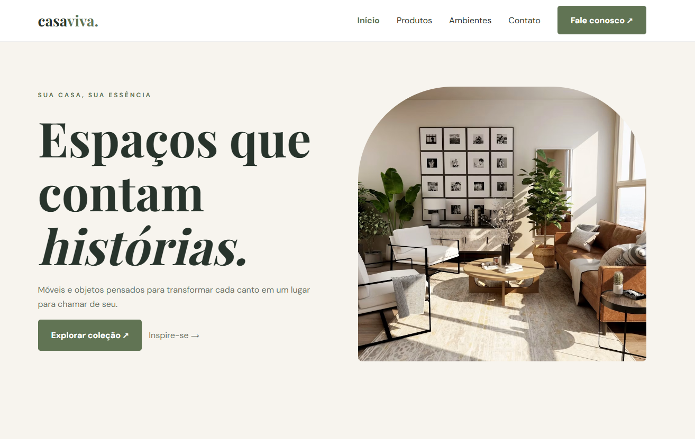
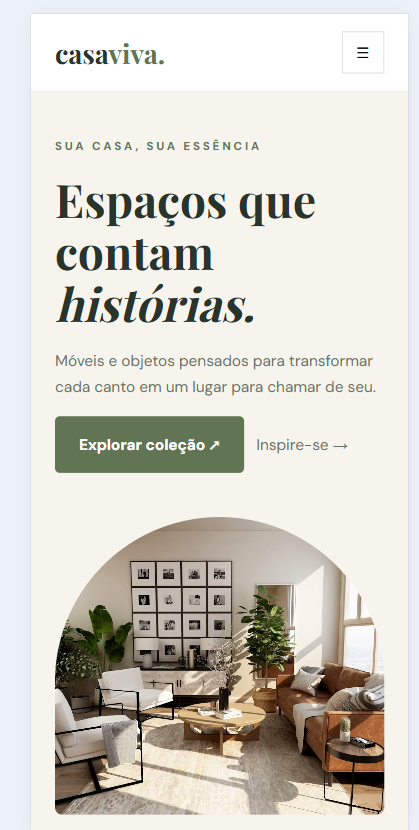
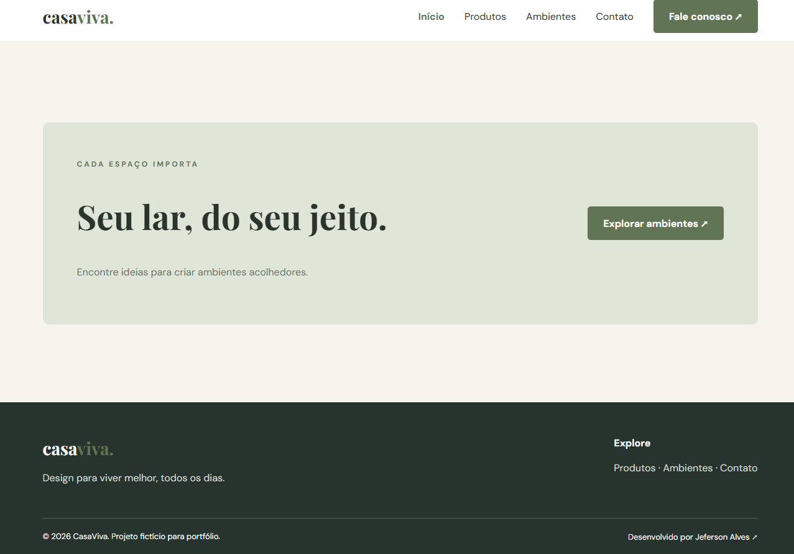

# CasaViva 🏡

**Site institucional responsivo de uma marca fictícia de móveis e decoração**, desenvolvido com HTML5, CSS3 e JavaScript. O projeto possui quatro páginas interligadas, catálogo demonstrativo com busca e filtros, galeria de ambientes e formulário interativo.


🌐 **[Acessar CasaViva — GitHub Pages](https://jefersonalvesrs.github.io/CasaViva/)**

## ✨ Funcionalidades

- Página inicial com apresentação da marca e produtos em destaque
- Catálogo de produtos com pesquisa por nome e filtros por categoria
- Galeria de seis ambientes com fotografias locais
- Formulário demonstrativo com validação e confirmação no navegador (sem envio de dados)
- Menu responsivo para dispositivos móveis
- Navegação entre quatro páginas e crédito do desenvolvedor no rodapé

## 🛠️ Tecnologias

- **HTML5:** estrutura semântica e navegação entre páginas
- **CSS3:** layout responsivo, Grid, Flexbox e media queries
- **JavaScript:** filtros, pesquisa, menu mobile e formulário
- **Fotografias locais:** arquivos em `assets/images/`
- **Google Fonts:** tipografia carregada externamente com fontes alternativas

## 📸 Capturas de tela

### Página inicial — desktop


### Página inicial — mobile


### Catálogo de produtos


### Rodapé e créditos


## 🚀 Executar localmente

1. Clone o repositório: `git clone https://github.com/JefersonAlvesrs/CasaViva.git`
2. Abra a pasta do projeto no VS Code.
3. Abra `index.html` no navegador ou utilize a extensão Live Server.

Não é necessário instalar dependências ou configurar backend.

## 📁 Estrutura do projeto

```text
CasaViva/
├── assets/
│   └── images/          # Fotografias locais
├── screenshots/         # Capturas para README
├── index.html
├── produtos.html
├── ambientes.html
├── contato.html
├── styles.css
├── script.js
└── README.md
```

## ℹ️ Observações

Projeto **fictício, criado para portfólio**. Marca, produtos, preços e atendimento são ilustrativos. O formulário não envia mensagens e não realiza compras ou pagamentos. As fotografias estão armazenadas localmente; é necessário conferir os direitos e as licenças de cada imagem antes de usos públicos ou comerciais.

## 👨‍💻 Autor

Desenvolvido por **Jeferson Alves** — [GitHub](https://github.com/JefersonAlvesrs).
